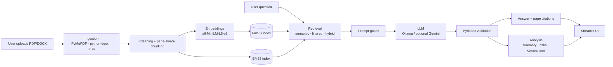

# Intelligent Contract & Document Risk Analyzer

A local-first GenAI application for reviewing contracts and business documents: grounded question answering (RAG) with page-level citations, clause and risk identification, version comparison, and structured summaries. It runs on free, open-source components (Ollama, Sentence Transformers, FAISS) and needs no paid API.

> **Disclaimer:** This tool highlights passages that may merit human review. It does not provide legal advice and does not determine legal compliance.

## Project status

This repository is under active development, built phase by phase. The table below is the source of truth for what works today.

| Phase | Scope | Status |
|---|---|---|
| 1 | Project setup, configuration, environment diagnostics, tests | ✅ Done |
| 2 | PDF / DOCX ingestion, OCR fallback, cleaning, page-aware chunking | 🔲 Planned |
| 3 | Embeddings and FAISS vector store | 🔲 Planned |
| 4 | RAG QA pipeline with citations and "insufficient evidence" handling | 🔲 Planned |
| 5 | Clause extraction and risk detection | 🔲 Planned |
| 6 | Document comparison and structured summaries | 🔲 Planned |
| 7 | Streamlit dashboard | 🔲 Planned |
| 8 | Evaluation harness and benchmark report | 🔲 Planned |
| 9 | Docker and final documentation | 🔲 Planned |

No benchmark numbers are published here until they have been measured by the evaluation harness (Phase 8).

## Planned features

1. **Document processing**: PDF (PyMuPDF), DOCX (python-docx), Tesseract OCR for scanned pages, page numbers preserved.
2. **RAG question answering**: semantic search, metadata filtering, optional BM25 hybrid retrieval, source attribution, refusal when evidence is insufficient.
3. **Risk identification**: unclear payment terms, unusual termination, missing deadlines, unlimited liability, automatic renewal, missing confidentiality, conflicting clauses. Each finding includes the clause, explanation, source page and a suggested question for human review.
4. **Version comparison**: `difflib` plus LLM semantic analysis of added, removed and modified clauses, with emphasis on financial terms and deadlines.
5. **Structured summaries**: parties, dates, obligations, termination, risks and missing information, validated with Pydantic.
6. **Conversational assistant** that retrieves supporting passages before answering.
7. **Evaluation**: a 25+ question dataset comparing semantic, metadata-filtered and hybrid retrieval (precision, recall, faithfulness, citation accuracy, unsupported-answer rate).

## Architecture



### Design principles

- **Citations come from metadata, not the model.** Each chunk stores document ID, filename and page; the LLM never invents references.
- **Validate every LLM output** against Pydantic schemas and reject or retry malformed responses.
- **Treat uploaded text as data.** Prompts isolate document content and screen for injected instructions.
- **Say "insufficient evidence"** rather than guess.
- **Local-first.** Ollama by default; Gemini is optional and key-based.

See [docs/architecture.md](docs/architecture.md) for module responsibilities.

## Tech stack

Python 3.11+ · Pydantic · Pandas · LangChain · Sentence Transformers · FAISS · rank-bm25 · PyMuPDF · python-docx · Tesseract · Ollama · Streamlit · FastAPI (optional) · pytest · Docker

## Project structure

```
app/          Streamlit entry point, pages, components
core/         Config, logging, exceptions, environment diagnostics   (implemented)
ingestion/    PDF, DOCX, OCR processors and chunking
rag/          Embeddings, vector store, retrieval, prompts, QA pipeline
analysis/     Risk detection, clause extraction, summaries, comparison
evaluation/   Benchmark runner and metrics
database/     SQLite persistence
sample_data/  Synthetic and public sample documents
tests/        Unit and integration tests
scripts/      Helper scripts
```

## Getting started

```bash
git clone https://github.com/<your-username>/intelligent-document-analyzer.git
cd intelligent-document-analyzer
python -m venv .venv && source .venv/bin/activate   # Windows: .venv\Scripts\activate
pip install -r requirements.txt
cp .env.example .env

# Local LLM (https://ollama.com)
ollama pull llama3.2:3b

# Tesseract OCR: apt install tesseract-ocr | brew install tesseract

python run.py check     # verify hardware, binaries and packages
pytest                  # run tests
```

## Configuration

All settings live in `.env` (see `.env.example`): LLM provider and model, embedding model, chunk size/overlap, `TOP_K`, and storage paths. API keys are read from the environment and are never logged.

## Roadmap

Work proceeds in the nine phases listed under *Project status*. Each phase ships with tests and keeps earlier modules compatible.

## License

MIT, see [LICENSE](LICENSE). Sample documents are synthetic unless explicitly labelled otherwise.
